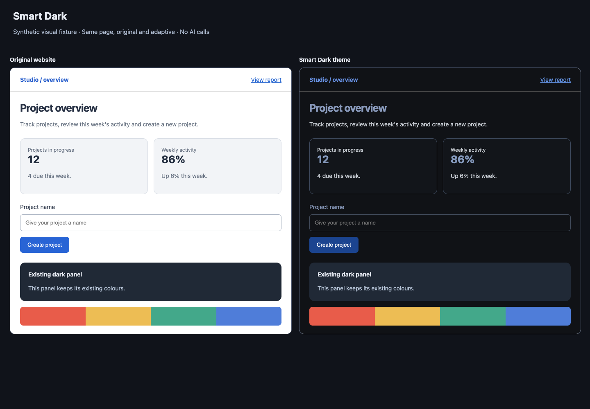
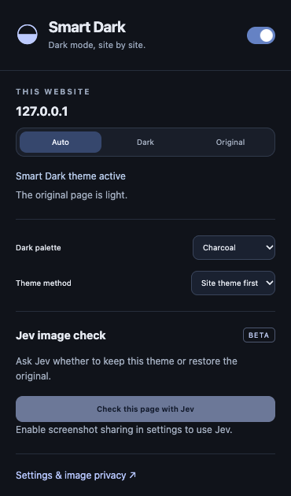
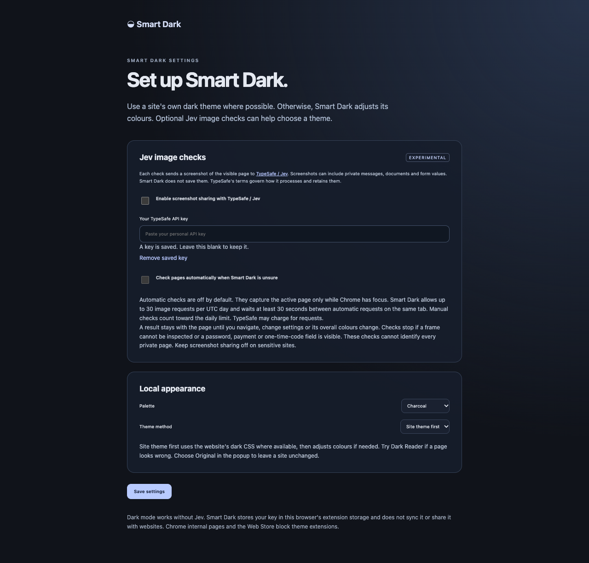

# Smart Dark

[](https://github.com/travisw84/smart-dark/actions/workflows/ci.yml)
[](https://github.com/travisw84/smart-dark/actions/workflows/codeql.yml)
[](https://github.com/travisw84/smart-dark/releases/latest)
[](LICENSE)


Smart Dark darkens websites in Chrome. It uses a site's own dark theme when the site has one. Otherwise it rewrites the site's colours so the page keeps its layout, hover states and brand colours. Optional Jev screenshot checks can keep the result or restore the original.

This beta loads locally in Chrome. It is not on the Chrome Web Store.



| Popup                    | Settings                       |
| ------------------------ | ------------------------------ |
|  |  |

## Install

1. Download `smart-dark-<version>.zip` from the [latest release](https://github.com/travisw84/smart-dark/releases/latest) and unzip it. Or clone the repository, then run `npm ci` and `npm run build` to produce the `dist` folder.
2. Open `chrome://extensions` in Chrome and turn on **Developer mode**.
3. Choose **Load unpacked** and select the unzipped folder, or the `dist` folder inside your clone.
4. Pin Smart Dark from the extensions menu, then reload any open website tabs once.
5. Turn off other dark mode extensions while you compare results. Smart Dark leaves another extension's styles in place.
6. Leave **Theme method** on **Site theme first**. Use Auto, Dark or Original for each site in the popup.

After rebuilding, choose Reload on the extension's card, then reload the website.

## How it works

- It samples up to 20 points of the visible page with its own styles switched off, resolves transparent backgrounds through their parents, and decides whether the page is light, dark or mixed. Dark pages are left alone.
- On a light page it first tries the site's own dark theme: a `dark` class, or a `data-theme`, `data-color-mode`, `data-bs-theme` or `data-mode` attribute that the site's CSS already defines. It checks that the page really turned dark. If the site changes the attribute back, it stops using that method for the page and uses the next one.
- Otherwise it mirrors the site's own stylesheets. Every colour in a rule (backgrounds, text, borders, outlines, fills, gradients) is mapped to a dark equivalent, and the mirrored rule keeps the same selector, media query and cascade layer. Hover, focus and other states, and elements added later, therefore follow the site's own rules. It reads `rgb()`, `hsl()`, `hwb()`, `oklab()`, `oklch()`, hex and named colours, and uses a one pixel canvas for `lab()`, `lch()`, `color-mix()` and wide gamut colours.
- CSS variables that hold colours get dark companions, and the rules that use them point at the companions. Tailwind style `rgb(... / var(--opacity))` colours keep their opacity variable. Shorthands such as `background` and `border` are mirrored as colour longhands only, so they never reset sizes or positions that other rules set.
- Stylesheets from other origins are fetched through the extension's service worker with credentials omitted and a size limit. Private network addresses are only fetched when the page itself is on that origin.
- A second pass handles what stylesheets cannot reach: inline styles, colours that stay light, and text with too little contrast. It tags elements with a few shared attributes, so many elements reuse one rule. Dark logos with transparent backgrounds are lightened. It works in short slices and does not read styles per element on every frame.
- Sites that remove the extension's style tags get them back.
- Dark Reader's MIT API is bundled only for the optional **Dark Reader** theme method. All executable code ships inside the extension.
- Turning Smart Dark off removes every style and attribute it added. Per-site settings are stored by origin, including the scheme and port.

## Jev screenshots

Open **Settings & image privacy**, add your own TypeSafe API key, and explicitly enable screenshot sharing. The key stays in extension-only local storage. It is never sent to page scripts or content scripts and is not synced. The saved key is never filled back into the settings form. Chrome stores the key in the browser profile. Smart Dark does not encrypt it separately.

Manual checks send a JPEG screenshot of the visible page, including the active dark theme, and a small set of original-colour measurements to `https://api.typesafe.ai/v1/systemone`. The request uses `jev-latest`, the documented image asset structure, and `TypeSafe-Danger-Zone-Images: true`. Jev image support is experimental. The extension accepts only a fixed set of answers with confidence of at least 0.8: keep the current treatment, restore the original appearance, or choose a neutral or warm palette. It never runs model-generated CSS, code or selectors.

Jev is asked whether the page should stay dark or return to the site's original appearance. A result applies to the page until you navigate, change settings, or the page's overall colours change. Scrolling and ordinary page updates keep it. If the original look of the page changes while a check is running, the result is discarded.

Screenshots can contain private messages, names, documents and other sensitive content. They are not redacted. Before capture and upload, the extension checks every embedded frame for visible password, payment and one-time-code inputs. It pauses if a frame cannot be inspected. It cannot identify every private page or inputs inside closed shadow roots. Turn off image sharing for private browsing. TypeSafe's processing and retention rules still apply. Images are not saved in extension storage or logs.

Automatic checks are a separate opt-in. They run only when local detection is ambiguous, in the active focused HTTP(S) tab, after local rendering, and retry up to three times per page. They are capped at 30 attempted image checks per UTC day across manual and automatic use, with a 30-second cooldown per tab for automatic uploads. Decisions are cached for up to one hour, for the current browser session only, under a SHA-256 digest of the page URL, the coarse look of the page and the treatment. Only the digest and the bounded decision are stored, not the URL, page text or screenshot. Provider calls time out after 12 seconds, and local rendering continues while a check runs or fails. API usage may incur charges. A request cap is not a spending cap.

No API key is bundled. The capture, request and decision flow is tested with synthetic pages and mocked provider responses. **Live Jev visual accuracy and latency have not been verified.**

## Permissions

- `storage`: local preferences, the protected personal key, the daily request cap and the session decision cache.
- `activeTab`: context for the extension popup.
- `webNavigation`: lists embedded frames, only to check screenshot safety. No navigation history is recorded.
- `<all_urls>` host permission: theming on every website, fetching cross-origin stylesheets, and Chrome's visible-tab screenshot API. Chrome requires the literal all-URLs permission for automatic captures. Content scripts and capture logic are limited to HTTP(S). There is no browsing history collection, analytics, ad tracking or remote code.

## Validation and development

```sh
npm test
npm run build
npx playwright install chromium
npm run test:e2e
npm audit
```

Browser tests load the built extension into a fresh disposable Chromium profile, using labelled synthetic pages and fake credentials. They cover conversion, native themes, restoration, hover rules, `oklch()` colours, CSS variables, inline styles, a 6,000 element page, cross-origin stylesheets, dark logos, Jev decision persistence and races, and timeout fallback. They do not touch your normal Chrome profile and send nothing to a real provider.

`node scripts/smoke-real-sites.mjs` loads a handful of real websites with the built extension and saves screenshots to `test-results/real-sites`. It needs network access and prints what each site did, so check the screenshots by eye. Pass URLs as arguments to try your own.

`node scripts/preview.mjs` serves a synthetic before and after gallery at `http://127.0.0.1:4178`. It uses the real adaptive renderer, with no credentials or AI calls.

See `docs/verification.md` for measured results.

## Limits

Some pages will still look better in their original theme. Pick Original for those in the popup.

- Colours come from a fixed mapping, not from a design. Text over a photograph can lose contrast, because the mapping cannot see the picture behind it.
- Only dark logos with transparent backgrounds that the extension can read are lightened. Cross-origin images, CSS background images and photographs are left alone.
- Shadow DOM, canvas, WebGL and inline SVG with hard-coded colours are not themed.
- Elements fixed by the second pass keep their colour on hover, because their colour is a snapshot.
- A light flash can show for a moment while a page's styles and layout load.
- Site theme first covers sites that switch theme through a class or one of the attributes above. Sites that follow only the system colour scheme use the rewritten colours instead.
- Chrome blocks extensions on its own pages and the Web Store.

Cross-site learning, region-selection repair and image-based region edits are ideas, not features.

## Credits

Dark Reader 4.9.133 is used under its MIT license. Its full license is included in `dist/DARK_READER_LICENSE.txt`. Jev is a TypeSafe service. Smart Dark is an independent local project.

## Contributing, privacy and licence

See [CONTRIBUTING.md](CONTRIBUTING.md) to help, [PRIVACY.md](PRIVACY.md) for what data goes where, [SECURITY.md](SECURITY.md) to report a vulnerability and [CHANGELOG.md](CHANGELOG.md) for releases. Smart Dark is released under the [MIT license](LICENSE). Bundled software is listed in [THIRD_PARTY_NOTICES.md](THIRD_PARTY_NOTICES.md).
